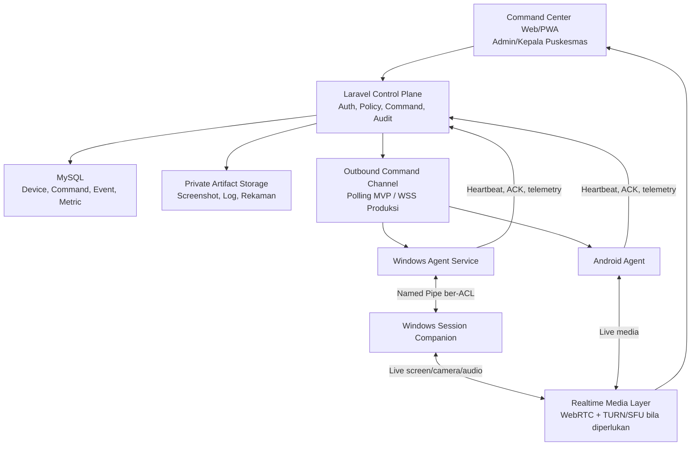
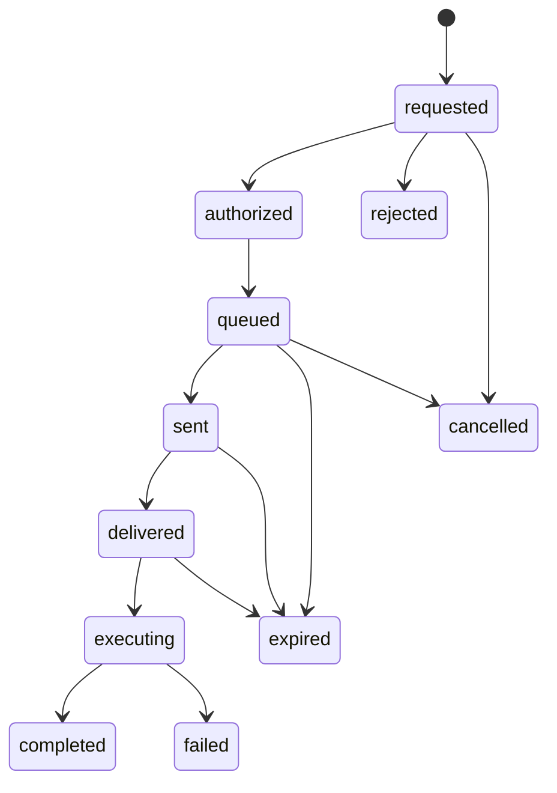

# Planning Pengembangan KabenSatuData Command Center Windows

**Versi dokumen:** 1.0  
**Tanggal:** 28 Juli 2026  
**Status:** Perencanaan sebelum eksekusi  
**Produk:** KabenSatuData Command Center, Windows Agent, dan Android Agent  
**Target perangkat:** Komputer/laptop resmi milik Puskesmas  

---

## 1. Ringkasan Eksekutif

Tujuan pengembangan adalah membuat sebuah installer Windows bernama sementara
`KabenSatuDataAgentSetup.exe`. Setelah installer dipasang pada komputer/laptop
resmi Puskesmas, perangkat akan:

1. Terdaftar ke server KabenSatuData menggunakan enrollment sekali pakai.
2. Menjalankan Agent secara otomatis sejak Windows menyala.
3. Mengirim status online/offline dan informasi kesehatan perangkat.
4. Menerima perintah yang sah dari Command Center.
5. Mendukung monitoring seperti screenshot, live screen, kamera, audio, proses,
   aplikasi, jaringan, dan tindakan maintenance sesuai kebijakan.
6. Muncul pada dashboard yang dapat diakses Kepala Puskesmas atau admin melalui
   website/PWA.
7. Menyimpan audit lengkap untuk setiap tindakan sensitif.

Website Laravel yang sudah online tetap menjadi **Control Plane** utama.
Windows Agent menjadi pelaksana di perangkat. Website tidak dapat memonitor
komputer tanpa Agent.

Target bentuk produk:

```text
KabenSatuData Command Center Web/PWA
├── Android Agent (APK yang sudah ada, akan distandarkan)
└── Windows Agent
    ├── Windows Service
    ├── Desktop Session Companion
    ├── Secure Updater
    └── Installer EXE/MSI
```

Prinsip utama:

> Agent selalu aktif dan siap di latar belakang. Kamera, mikrofon, live screen,
> file, dan remote input hanya aktif berdasarkan perintah, permission, kebijakan,
> batas waktu, dan audit.

---

## 2. Ketentuan Penggunaan yang Tidak Boleh Berubah

1. Agent hanya boleh dipasang pada perangkat resmi milik Puskesmas.
2. Agent dilarang dipasang pada perangkat pribadi petugas.
3. Setiap perangkat harus memiliki identitas, lokasi/Puskesmas, dan penanggung
   jawab yang tercatat.
4. Akses kamera, mikrofon, live screen, file, dan remote control harus dibatasi
   dengan permission khusus.
5. Semua tindakan admin harus tercatat: pengguna, perangkat, waktu, alamat IP,
   jenis perintah, alasan, status, dan hasil.
6. Tidak dibuat fungsi keylogger, pencurian kata sandi, penyadapan kredensial,
   atau upaya melewati keamanan Windows.
7. Agent tidak membuka port HTTP tanpa autentikasi pada jaringan lokal.
8. Tidak ada perekaman kamera/audio terus-menerus sebagai pengaturan bawaan.
9. Installer, Agent, dan paket pembaruan harus ditandatangani sebelum produksi.
10. Setiap Puskesmas harus memiliki SOP penggunaan dan retensi data monitoring.

---

## 3. Kondisi Sistem Saat Ini

### 3.1 Yang sudah tersedia

- Laravel 11 dengan PHP 8.2.
- Autentikasi pengguna dan Laravel Sanctum.
- Role/permission melalui Spatie Permission dan Filament Shield.
- Queue menggunakan database.
- Scheduler Laravel sudah digunakan.
- Command Center web pada `resources/views/command-center/index.blade.php`.
- Command Center controller pada `app/Http/Controllers/CommandCenterController.php`.
- Endpoint monitoring Android pada `routes/api.php`.
- FCM untuk mengirim perintah ke APK Android.
- Penyimpanan screenshot, activity log, file, audio, SMS, panggilan, dan kontak
  untuk APK.
- Website sudah berjalan pada hosting/cPanel.

### 3.2 Kekurangan yang wajib diperbaiki

- Command Center web masih menggunakan URL token rahasia sebagai akses utama.
- Terdapat fallback token Command Center yang ditulis di source code.
- Beberapa endpoint mobile hanya memeriksa Sanctum tanpa otorisasi per aksi.
- Status command masih bersifat optimistis; belum ada ACK `delivered`,
  `executing`, `completed`, dan `failed`.
- Identitas perangkat masih banyak bergantung pada nama perangkat/cache.
- Cache digunakan sebagai sumber utama status kamera/perangkat.
- Port streaming lokal Android 8080/8081 belum memiliki autentikasi yang memadai.
- Belum ada model perangkat lintas platform Android/Windows yang permanen.
- Belum ada Windows Agent.
- Shared hosting cPanel belum dipastikan mendukung WebSocket daemon,
  Supervisor, dan TURN/media relay.
- Dokumen deployment lama berisi kredensial dalam teks biasa. Kredensial tersebut
  harus dihapus dari dokumentasi/repository dan dirotasi sebelum tahap produksi.
- File kredensial Firebase tidak boleh berada di public directory atau ikut dalam
  paket distribusi. Lokasi dan riwayat eksposurnya harus diaudit.

---

## 4. Sasaran dan Definition of Done

Pengembangan dianggap memenuhi ekspektasi dasar jika semua kondisi berikut
tercapai:

### 4.1 Enrollment

- Admin dapat membuat kode enrollment sekali pakai.
- Installer menerima kode enrollment dan mendaftarkan perangkat.
- Kode enrollment memiliki waktu kedaluwarsa dan tidak dapat digunakan ulang.
- Perangkat memperoleh UUID permanen dan kredensial unik.
- Perangkat muncul pada dashboard maksimal 30 detik setelah instalasi selesai.

### 4.2 Background operation

- Service otomatis berjalan saat Windows boot.
- Companion otomatis berjalan pada user session.
- Agent kembali tersambung setelah reboot, sleep/resume, dan internet terputus.
- Agent tidak membutuhkan aplikasi utama dibuka oleh pengguna.
- Agent dapat memperbarui dirinya menggunakan paket yang sah.

### 4.3 Monitoring

- Online, idle, offline, last seen, uptime, dan user session tampil akurat.
- CPU, RAM, disk, network, OS, versi Agent, aplikasi, dan proses dapat dilihat.
- Screenshot on-demand menghasilkan ACK dan artifact yang dapat dibuka admin.
- Live screen dan kamera dapat dimulai/dihentikan dari dashboard pada perangkat
  yang mendukung.
- Restart, shutdown, lock, dan pengambilan diagnostik memiliki hasil yang jelas.
- Perangkat yang tidak memiliki kamera atau menolak permission menampilkan error
  yang benar, bukan status sukses palsu.

### 4.4 Keamanan dan audit

- Tidak ada akses Command Center produksi hanya dengan URL rahasia.
- Setiap endpoint admin menggunakan login, policy, dan permission.
- Setiap endpoint Agent menggunakan identitas perangkat, replay protection, dan
  rate limiting.
- Seluruh command sensitif tercatat.
- Artifact sensitif tidak dapat diakses melalui URL publik permanen.
- Tidak ada port inbound Agent yang dibuka pada komputer Puskesmas.

### 4.5 Deployment

- Deployment backend tidak merusak website yang sudah online.
- Migration bersifat additive pada tahap awal.
- Tersedia backup, langkah update, smoke test, dan rollback.
- Daftar file cPanel dicatat untuk setiap release.
- Installer pilot dapat diunduh admin dan diverifikasi checksum/signature.

---

## 5. Ruang Lingkup Fitur

### 5.1 Fitur selalu aktif

- Heartbeat.
- Online/offline/idle.
- OS, hostname, serial/hardware ID yang diizinkan.
- Versi Agent.
- CPU, RAM, disk, uptime.
- Adapter jaringan dan IP.
- User session aktif.
- Status antivirus dan update bila API Windows mendukung.
- Status modul dan permission Agent.
- Alert kesehatan perangkat.

### 5.2 Fitur terjadwal

- Inventory aplikasi.
- Ringkasan proses.
- Ringkasan penggunaan resource.
- Pemeriksaan ruang disk.
- Pemeriksaan service/aplikasi penting.
- Screenshot terjadwal hanya jika kebijakan Puskesmas mengizinkan.

### 5.3 Fitur on-demand

- Screenshot.
- Live screen.
- Kamera snapshot/live.
- Audio dengan durasi terbatas.
- Daftar aplikasi dan proses.
- Diagnostic bundle.
- Lock/restart/shutdown.
- Restart service yang masuk allowlist.
- File browse/download/upload pada direktori yang diizinkan.
- Remote assistance.

### 5.4 Bukan sasaran MVP

- Terminal atau PowerShell bebas dari website.
- Keylogger.
- Pengambilan kredensial/browser password.
- Kamera/audio yang selalu merekam.
- Uninstall paksa aplikasi apa pun tanpa policy.
- Remote keyboard/mouse tersembunyi.
- Monitoring perangkat pribadi.
- Dukungan macOS/Linux.

---

## 6. Arsitektur Target



### 6.1 Laravel Control Plane

Laravel bertanggung jawab atas:

- Login dan session admin.
- Role, permission, dan policy.
- Enrollment perangkat.
- Registrasi capability.
- Command queue dan state machine.
- Audit.
- Telemetry dan alert.
- Metadata artifact.
- Signaling media bila infrastruktur mendukung.
- Distribusi release Agent secara terautentikasi.

Laravel tidak boleh menjadi relay frame JPEG melalui request PHP terus-menerus
untuk produksi berskala banyak perangkat.

### 6.2 Windows Agent Service

Teknologi yang direkomendasikan:

- C#/.NET Worker Service.
- Dipasang sebagai Windows Service.
- Startup otomatis.
- Menyimpan konfigurasi non-rahasia di `%ProgramData%\KabenSatuData\Agent`.
- Menyimpan rahasia dengan Windows DPAPI/Certificate Store.
- Koneksi hanya outbound melalui HTTPS/WSS.
- Command executor berbasis allowlist.
- Offline queue lokal menggunakan SQLite atau append-only journal.
- Logging ke Windows Event Log dan rolling local log tanpa data sensitif.

### 6.3 Windows Session Companion

Teknologi yang direkomendasikan:

- C#/.NET desktop app (WPF atau WinUI setelah proof of concept).
- Startup saat user login.
- Berkomunikasi dengan Service melalui Named Pipe dengan ACL ketat.
- Menangani screen, camera, microphone, screenshot, tray/status, dan remote
  assistance.
- Tidak menyimpan token server secara langsung.
- Menampilkan indikator ketika kamera, mikrofon, atau screen session aktif.

### 6.4 Installer dan updater

Output:

- `KabenSatuDataAgentSetup.exe` untuk pemasangan manual.
- `KabenSatuDataAgent.msi` untuk deployment terkelola.
- `Install-KabenSatuDataAgent.ps1` sebagai bootstrap deployment massal, bukan
  sebagai Agent utama.

Installer:

- Meminta hak administrator.
- Menginstal Service dan Companion.
- Menjalankan enrollment.
- Menambahkan uninstall resmi.
- Menambahkan service recovery.
- Memverifikasi prasyarat Windows.
- Tidak memasukkan token permanen di command line/log.

Updater:

- Mengambil release manifest melalui HTTPS.
- Memeriksa versi, SHA-256, dan digital signature.
- Mendukung staged rollout.
- Dapat rollback ke satu versi sebelumnya.

---

## 7. Keputusan Infrastruktur cPanel

Website yang sudah online tetap dipakai. Namun kemampuan hosting harus diverifikasi
sebelum menentukan transport realtime.

### 7.1 Jalur MVP yang kompatibel shared hosting

- Agent melakukan outbound HTTPS polling setiap 5–10 detik untuk command.
- Heartbeat setiap 60 detik.
- Telemetry ringkas setiap 5 menit atau saat berubah signifikan.
- Database queue digunakan untuk pekerjaan pendek.
- Laravel Scheduler dijalankan melalui cron setiap menit.
- Screenshot/artifact diunggah melalui HTTPS multipart/chunk.
- Browser mengambil status dengan polling atau Server-Sent Events jika stabil.

Kelebihan:

- Tidak membutuhkan daemon WebSocket di cPanel.
- Risiko terhadap website online lebih rendah.
- Cocok untuk membuktikan enrollment, heartbeat, command ACK, screenshot, dan
  maintenance.

Kekurangan:

- Latensi command sekitar 5–10 detik.
- Tidak cocok sebagai jalur media live utama.

### 7.2 Jalur produksi realtime

Jika cPanel tidak menyediakan Supervisor/WebSocket yang stabil:

- Laravel dan MySQL tetap di cPanel.
- Tambahkan realtime gateway di VPS/service terpisah.
- Gunakan WSS untuk command delivery.
- Gunakan WebRTC untuk kamera/screen/audio.
- Sediakan TURN server untuk jaringan yang tidak mendukung koneksi langsung.
- Gunakan SFU hanya jika satu stream harus ditonton banyak admin.

Keputusan **Go/No-Go realtime** baru dibuat setelah pengujian hosting:

- Apakah SSH tersedia?
- Apakah cron setiap menit tersedia?
- Apakah background process/Supervisor tersedia?
- Apakah WebSocket pass-through tersedia?
- Berapa upload limit, request timeout, disk quota, dan bandwidth?
- Apakah Redis tersedia?
- Apakah object storage eksternal tersedia?

---

## 8. Model Data yang Direncanakan

Nama final dapat disesuaikan saat implementasi, tetapi tanggung jawab tabel tidak
boleh dicampur.

### 8.1 `managed_sites`

- `id`
- `uuid`
- `name`
- `code`
- `is_active`
- timestamps

Catatan: walaupun saat ini satu website dapat digunakan oleh satu Puskesmas,
model site tetap dibuat agar pembatasan perangkat tidak bergantung pada nama.

### 8.2 `managed_devices`

- `id`, `uuid`
- `managed_site_id`
- `platform`: `android` atau `windows`
- `device_name`, `hostname`
- `os_name`, `os_version`
- `agent_version`
- `hardware_fingerprint_hash`
- `status`
- `last_seen_at`
- `last_ip`
- `capabilities` JSON
- `permissions_state` JSON
- `enrolled_at`, `revoked_at`
- timestamps

### 8.3 `device_enrollment_tokens`

- Token disimpan dalam bentuk hash.
- Site tujuan.
- Pembuat token.
- Waktu kedaluwarsa.
- Batas penggunaan.
- Waktu digunakan.
- Metadata instalasi.

### 8.4 `device_credentials`

- `managed_device_id`
- Public key atau token hash.
- Credential version.
- Rotated/revoked timestamps.
- Tidak menyimpan private key Agent.

### 8.5 `device_heartbeats`

- Perangkat.
- Timestamp server.
- Uptime, user session, IP, agent version.
- Ringkasan health.
- Penyimpanan dapat dipadatkan agar tabel tidak tumbuh tanpa batas.

### 8.6 `device_metrics`

- CPU, RAM, disk, network.
- Timestamp.
- Retention dan aggregation.

### 8.7 `device_commands`

- UUID command.
- Perangkat target.
- Nama command dan version.
- Payload tervalidasi.
- Requested by.
- Alasan.
- Priority.
- Status.
- Requested/sent/delivered/started/completed/failed/expired timestamps.
- Expires at.
- Idempotency key.
- Result summary dan error code.

### 8.8 `device_command_events`

- Riwayat append-only perubahan command.
- Sumber event: server/agent/admin.
- Timestamp server dan agent.
- Detail aman tanpa credential.

### 8.9 `device_artifacts`

- Perangkat dan command.
- Jenis: screenshot, diagnostic, audio, recording, file.
- Private storage path.
- MIME, size, checksum.
- Dibuat/kedaluwarsa/dihapus.
- Download hanya melalui authorized controller.

### 8.10 `device_policies`

- Site/perangkat.
- Capability yang diizinkan.
- Jadwal.
- Batas durasi.
- Direktori file yang diizinkan.
- Retention.
- Versi policy.

### 8.11 `device_alerts`

- Jenis, severity, status.
- Perangkat.
- Detected/resolved timestamps.
- Acknowledged by.

### 8.12 `command_center_audit_logs`

- Actor.
- Site dan perangkat.
- Action.
- Alasan.
- Request IP/user agent.
- Hasil.
- Timestamp.
- Metadata yang sudah disanitasi.

### 8.13 `agent_releases`

- Version/channel.
- Platform/architecture.
- Private artifact path.
- SHA-256.
- Signature.
- Minimum supported version.
- Rollout percentage.
- Published/revoked timestamps.

---

## 9. Kontrak API yang Direncanakan

Semua endpoint baru diberi versi, misalnya `/api/agent/v1`.

### 9.1 Endpoint Agent

```text
POST /api/agent/v1/enroll
POST /api/agent/v1/auth/refresh
POST /api/agent/v1/heartbeat
POST /api/agent/v1/telemetry
GET  /api/agent/v1/policy
GET  /api/agent/v1/commands/next
POST /api/agent/v1/commands/{uuid}/delivered
POST /api/agent/v1/commands/{uuid}/started
POST /api/agent/v1/commands/{uuid}/completed
POST /api/agent/v1/commands/{uuid}/failed
POST /api/agent/v1/artifacts/init
POST /api/agent/v1/artifacts/{uuid}/chunk
POST /api/agent/v1/artifacts/{uuid}/complete
GET  /api/agent/v1/releases/latest
```

### 9.2 Endpoint Admin

```text
GET    /api/command-center/v1/devices
GET    /api/command-center/v1/devices/{uuid}
POST   /api/command-center/v1/devices/{uuid}/commands
GET    /api/command-center/v1/commands/{uuid}
POST   /api/command-center/v1/commands/{uuid}/cancel
GET    /api/command-center/v1/devices/{uuid}/metrics
GET    /api/command-center/v1/devices/{uuid}/artifacts
GET    /api/command-center/v1/artifacts/{uuid}/download
DELETE /api/command-center/v1/artifacts/{uuid}
GET    /api/command-center/v1/audit
POST   /api/command-center/v1/enrollments
DELETE /api/command-center/v1/devices/{uuid}/credential
```

### 9.3 Aturan API

- Semua payload menggunakan schema/version.
- Device direferensikan dengan UUID, bukan nama.
- Request Agent memiliki timestamp dan nonce untuk replay protection.
- Payload command memakai allowlist dan validator per command.
- Maksimum ukuran body ditentukan per endpoint.
- Download artifact memakai authorization dan response `no-store`.
- Error memiliki `error_code` yang dapat diproses Agent.
- Endpoint sensitif mempunyai rate limit terpisah.
- Tidak ada secret dalam query string.

---

## 10. Command State Machine



Ketentuan:

- Setiap command memiliki UUID.
- Command yang sama tidak dijalankan dua kali.
- Agent menyimpan idempotency journal lokal.
- ACK dari Agent dibedakan dari HTTP/FCM/WSS delivery.
- Command memiliki TTL.
- Command sensitif memiliki batas durasi.
- `STOP_*` harus tetap dapat dikirim pada sesi yang bermasalah.
- Server menutup sesi yang melewati timeout.

---

## 11. Role dan Permission

Role yang disarankan:

- `command_center_viewer`
- `command_center_operator`
- `command_center_security_admin`
- `super_admin`
- `command_center_auditor`

Permission minimum:

```text
command_center.view
device.view
device.enroll
device.revoke
device.view_metrics
device.view_processes
device.capture_screenshot
device.view_screen
device.view_camera
device.capture_audio
device.browse_files
device.download_files
device.remote_input
device.lock
device.restart
device.shutdown
device.run_maintenance
device.manage_policy
artifact.download
artifact.delete
audit.view
agent_release.manage
```

Kebijakan:

- Kepala Puskesmas tidak otomatis memperoleh seluruh tindakan security admin.
- Permission kamera, audio, file, dan remote input dipisahkan.
- Super admin dapat melihat semua site.
- Operator hanya dapat mengakses perangkat pada site yang ditugaskan.
- Semua tindakan sensitif meminta alasan.
- Dapat ditambahkan approval kedua untuk audio, file sensitif, atau remote input.

---

## 12. Rancangan Dashboard

### 12.1 Halaman daftar perangkat

- Filter site, platform, status, versi Agent, alert.
- Ringkasan online/idle/offline.
- Badge permission/capability.
- Last seen dan health.
- Bulk action hanya untuk tindakan aman.

### 12.2 Halaman detail perangkat

Tab:

1. Overview.
2. Health dan metrics.
3. Live screen.
4. Camera/audio.
5. Screenshot/artifact.
6. Applications/processes.
7. Network.
8. Files.
9. Maintenance.
10. Command history.
11. Audit.
12. Policy.

### 12.3 Tampilan mobile/PWA

- Website dibuat responsive.
- Kepala Puskesmas dapat memasang PWA di ponsel/laptop.
- APK admin bukan dependency MVP.
- APK admin kelak memakai API dan permission yang sama.
- Service worker Command Center tidak boleh cache API, screenshot, audio, video,
  atau halaman yang mengandung data sensitif.

---

## 13. Rancangan Modul Windows Agent

Struktur source yang direncanakan:

```text
KabenSatuDataWindowsAgent/
├── KabenSatuData.Agent.sln
├── src/
│   ├── KabenSatuData.Agent.Service/
│   ├── KabenSatuData.Agent.Companion/
│   ├── KabenSatuData.Agent.Contracts/
│   ├── KabenSatuData.Agent.Core/
│   ├── KabenSatuData.Agent.Windows/
│   ├── KabenSatuData.Agent.Updater/
│   └── KabenSatuData.Agent.Installer/
├── tests/
│   ├── KabenSatuData.Agent.UnitTests/
│   └── KabenSatuData.Agent.IntegrationTests/
├── scripts/
│   ├── build.ps1
│   ├── package.ps1
│   └── verify-package.ps1
└── README.md
```

Modul:

- Enrollment client.
- Credential store.
- API client.
- Heartbeat worker.
- Telemetry collector.
- Command receiver.
- Command validator/executor.
- Idempotency journal.
- Policy manager.
- Artifact uploader.
- Inventory collector.
- Process/service collector.
- Screen capture module.
- Camera/audio module.
- Power/session action module.
- File access sandbox.
- Realtime media module.
- Update manager.
- Watchdog dan health reporter.

---

## 14. Default Teknis untuk Pilot

Nilai ini menjadi default sampai ada keputusan lain:

| Item | Default pilot |
|---|---|
| Windows | Windows 10/11 64-bit |
| Command polling | 5–10 detik |
| Heartbeat | 60 detik |
| Telemetry | 5 menit atau significant change |
| Offline threshold | 3 heartbeat terlewat |
| Enrollment token | Sekali pakai, 10 menit |
| Command TTL biasa | 2 menit |
| Command TTL sensitif | 30–60 detik |
| Live session maksimum | 15 menit |
| Screenshot retention | 7 hari |
| Audio/video retention | 3–7 hari |
| Metrics detail retention | 30 hari |
| Audit retention | Minimal 1 tahun atau sesuai SOP |
| Idle Agent CPU | Target rata-rata < 2% |
| Idle Agent RAM | Target total service+companion < 150 MB |
| Idle bandwidth | Target < 10 MB/hari/perangkat |
| Inbound port Agent | Tidak ada |

Semua retention harus dapat dikonfigurasi per site.

---

## 15. Tahapan Eksekusi

### Fase 0 — Keputusan dan hardening awal

Deliverable:

- Persetujuan ruang lingkup MVP.
- Inventaris Windows 10/11 dan jumlah perangkat.
- Verifikasi kemampuan cPanel.
- Kebijakan penggunaan dan retention.
- Permission matrix.
- Rotasi secret yang pernah ditulis dalam source/dokumentasi.
- Command Center lama dipindahkan di belakang login.
- Secret URL ditandai deprecated.

Exit criteria:

- Tidak ada hardcoded default secret.
- Akun admin dan role sudah ditentukan.
- Backup production tervalidasi.
- Pilot site dan perangkat pilot dipilih.

### Fase 1 — Fondasi backend

Deliverable:

- Schema managed device.
- Enrollment.
- Identitas Agent.
- Heartbeat.
- Command queue dan event.
- Artifact metadata/private download.
- Policy dan audit.
- API v1.
- Unit/feature test.

Exit criteria:

- Dummy Agent dapat enroll.
- Device muncul online/offline.
- Command dapat bergerak dari requested hingga completed/failed.
- Pengguna di luar permission tidak dapat mengakses perangkat/artifact.

### Fase 2 — Windows Agent baseline

Deliverable:

- Service.
- Companion.
- Installer.
- Enrollment UI/CLI aman.
- Heartbeat.
- Inventory.
- CPU/RAM/disk/network.
- Process/application list.
- Service recovery.
- Local log dan offline queue.

Exit criteria:

- Agent kembali aktif setelah reboot.
- Agent pulih setelah jaringan terputus.
- Tidak ada token di log.
- Tidak ada inbound port.
- Uninstall dan reinstall berjalan bersih.

### Fase 3 — Dashboard Windows

Deliverable:

- Daftar perangkat lintas Android/Windows.
- Detail perangkat.
- Metrics.
- Command history.
- Enrollment management.
- Audit.
- Permission-aware buttons.
- Responsive/PWA shell aman.

Exit criteria:

- Kepala Puskesmas dapat melihat perangkat sesuai site.
- Tombol yang tidak memiliki permission tidak dapat digunakan melalui UI maupun
  direct API.
- Status tidak bergantung pada nama perangkat/cache.

### Fase 4 — Screenshot dan maintenance

Deliverable:

- Screenshot on-demand.
- Diagnostic bundle.
- Lock/restart/shutdown.
- Restart service allowlist.
- Artifact upload dan retention.

Exit criteria:

- Setiap tindakan mempunyai ACK dan audit.
- Duplicate command tidak dijalankan ulang.
- Artifact tidak dapat diakses tanpa login/permission.
- Timeout dan cleanup bekerja.

### Fase 5 — Live screen, camera, dan audio

Deliverable:

- Proof of concept Windows capture API.
- Capability/permission detection.
- WebRTC signaling.
- TURN fallback.
- Start/stop/timeout.
- Indikator sesi.
- Adaptive quality.

Exit criteria:

- Berhasil pada matriks Windows pilot.
- Stop session selalu menutup capture.
- Server PHP tidak menerima frame polling kontinu sebagai arsitektur produksi.
- Bandwidth dan resource memenuhi target.

### Fase 6 — Remote assistance dan file

Deliverable:

- Remote input dengan permission khusus.
- File sandbox.
- Upload/download chunked.
- Allowlist direktori.
- Maintenance job signed/versioned.

Exit criteria:

- Tidak ada arbitrary shell.
- Path traversal dan symlink escape ditolak.
- Semua file memiliki checksum dan audit.
- Remote input dapat dihentikan dari Agent dan server.

### Fase 7 — Pilot produksi

Urutan pilot:

1. Satu laptop pengembangan.
2. Satu komputer Puskesmas nonkritis.
3. Tiga hingga lima perangkat berbeda.
4. Satu unit kerja lengkap.
5. Rollout bertahap.

Exit criteria:

- Minimal tujuh hari operasi stabil.
- Reboot/sleep/network recovery tervalidasi.
- Tidak ada gangguan aplikasi pelayanan.
- SOP dan admin training selesai.
- Rollback diuji.

---

## 16. Strategi Pengujian

### 16.1 Backend

- Enrollment valid, expired, reused, revoked.
- Device credential valid/invalid/revoked.
- Replay timestamp dan nonce.
- Role/permission/tenant isolation.
- IDOR pada device/artifact/command.
- Command TTL, cancel, retry, duplicate.
- Artifact size, MIME, checksum, retention.
- Rate limit.
- Audit completeness.
- Database migration dan rollback rehearsal.

### 16.2 Windows Agent

- Windows 10/11.
- Standard user dan administrator.
- User login/logout/lock.
- Reboot.
- Sleep/hibernate/resume.
- Internet putus/nyambung.
- Proxy/firewall.
- Clock tidak tepat.
- Tidak ada kamera/mikrofon.
- Permission kamera/mikrofon ditolak.
- Satu dan multi-monitor.
- Agent/service dihentikan.
- Disk penuh.
- Server error/timeout.
- Command duplikat.
- Update berhasil/gagal/rollback.
- Uninstall/reinstall.

### 16.3 Media

- LAN yang sama.
- Jaringan berbeda/NAT.
- TURN fallback.
- Bandwidth rendah.
- Ganti kualitas.
- Stop dan timeout.
- Browser desktop/mobile.
- Banyak viewer jika memang dibutuhkan.

### 16.4 Production/cPanel

- PHP 8.2 extension yang diperlukan.
- Cron scheduler.
- Queue execution.
- Upload limit dan timeout.
- Storage permission.
- Database connection saturation.
- Cache/route/view build.
- Disk quota.
- Backup dan restore.
- Error log.

### 16.5 Load test

- Uji minimal dua kali jumlah perangkat pilot.
- Heartbeat serentak.
- Command burst.
- Upload screenshot bersamaan.
- Dashboard multi-admin.
- Retention cleanup.

---

## 17. Observability dan Operasional

Dashboard operasional:

- Jumlah Agent online/offline/outdated.
- Command success/failure/latency.
- Queue depth.
- Artifact storage usage.
- Error rate.
- Agent version distribution.
- Perangkat yang permission-nya bermasalah.

Alert server:

- Queue tidak diproses.
- Cron tidak berjalan.
- Storage hampir penuh.
- Error Agent meningkat.
- Banyak command gagal.
- Agent release gagal.
- Credential/device melakukan request mencurigakan.

Log:

- Correlation ID per request/command.
- Tidak menyimpan token, private key, gambar, atau isi file dalam log.
- Log sensitif hanya dapat dilihat auditor yang sah.

---

## 18. Daftar File yang Direncanakan untuk Repository

Daftar berikut adalah impact map sebelum implementasi. Nama dapat berubah kecil
saat coding, tetapi setiap perubahan harus dicatat pada release manifest.

### 18.1 File/folder baru Laravel

```text
app/Enums/DeviceCommandStatus.php
app/Enums/ManagedDevicePlatform.php
app/Enums/ManagedDeviceStatus.php

app/Http/Controllers/API/Agent/V1/AgentEnrollmentController.php
app/Http/Controllers/API/Agent/V1/AgentHeartbeatController.php
app/Http/Controllers/API/Agent/V1/AgentTelemetryController.php
app/Http/Controllers/API/Agent/V1/AgentCommandController.php
app/Http/Controllers/API/Agent/V1/AgentArtifactController.php
app/Http/Controllers/API/Agent/V1/AgentPolicyController.php
app/Http/Controllers/API/Agent/V1/AgentReleaseController.php

app/Http/Controllers/API/CommandCenter/V1/ManagedDeviceController.php
app/Http/Controllers/API/CommandCenter/V1/DeviceCommandController.php
app/Http/Controllers/API/CommandCenter/V1/DeviceArtifactController.php
app/Http/Controllers/API/CommandCenter/V1/DeviceAuditController.php
app/Http/Controllers/API/CommandCenter/V1/EnrollmentController.php

app/Http/Middleware/AuthenticateManagedDevice.php
app/Http/Middleware/VerifyDeviceRequestSignature.php

app/Http/Requests/Agent/
app/Http/Requests/CommandCenter/

app/Jobs/ExpireDeviceCommands.php
app/Jobs/PruneDeviceHeartbeats.php
app/Jobs/PruneDeviceArtifacts.php
app/Jobs/EvaluateDeviceAlerts.php

app/Models/ManagedSite.php
app/Models/ManagedDevice.php
app/Models/DeviceEnrollmentToken.php
app/Models/DeviceCredential.php
app/Models/DeviceHeartbeat.php
app/Models/DeviceMetric.php
app/Models/DeviceCommand.php
app/Models/DeviceCommandEvent.php
app/Models/DeviceArtifact.php
app/Models/DevicePolicy.php
app/Models/DeviceAlert.php
app/Models/CommandCenterAuditLog.php
app/Models/AgentRelease.php

app/Policies/ManagedDevicePolicy.php
app/Policies/DeviceArtifactPolicy.php

app/Services/CommandCenter/DeviceEnrollmentService.php
app/Services/CommandCenter/DeviceAuthenticationService.php
app/Services/CommandCenter/DeviceCommandService.php
app/Services/CommandCenter/DeviceArtifactService.php
app/Services/CommandCenter/DevicePolicyService.php
app/Services/CommandCenter/CommandCenterAuditService.php
app/Services/CommandCenter/AgentReleaseService.php

config/command-center.php

database/migrations/YYYY_MM_DD_000001_create_managed_sites_table.php
database/migrations/YYYY_MM_DD_000002_create_managed_devices_table.php
database/migrations/YYYY_MM_DD_000003_create_device_enrollment_tokens_table.php
database/migrations/YYYY_MM_DD_000004_create_device_credentials_table.php
database/migrations/YYYY_MM_DD_000005_create_device_heartbeats_table.php
database/migrations/YYYY_MM_DD_000006_create_device_metrics_table.php
database/migrations/YYYY_MM_DD_000007_create_device_commands_table.php
database/migrations/YYYY_MM_DD_000008_create_device_command_events_table.php
database/migrations/YYYY_MM_DD_000009_create_device_artifacts_table.php
database/migrations/YYYY_MM_DD_000010_create_device_policies_table.php
database/migrations/YYYY_MM_DD_000011_create_device_alerts_table.php
database/migrations/YYYY_MM_DD_000012_create_command_center_audit_logs_table.php
database/migrations/YYYY_MM_DD_000013_create_agent_releases_table.php
database/migrations/YYYY_MM_DD_000014_create_managed_site_user_table.php

database/seeders/CommandCenterPermissionSeeder.php

resources/views/command-center/devices/index.blade.php
resources/views/command-center/devices/show.blade.php
resources/views/command-center/enrollments/index.blade.php
resources/views/command-center/audit/index.blade.php
resources/views/command-center/releases/index.blade.php

resources/js/src/command-center/
resources/css/command-center.css

tests/Feature/CommandCenter/
tests/Unit/CommandCenter/
```

### 18.2 File Laravel yang diperkirakan berubah

```text
app/Models/User.php
app/Providers/AuthServiceProvider.php
bootstrap/app.php
config/app.php
config/filesystems.php
config/queue.php
resources/views/command-center/index.blade.php
resources/views/layouts/admin.blade.php
routes/api.php
routes/web.php
routes/console.php
```

Kondisional jika dependency berubah:

```text
composer.json
composer.lock
package.json
package-lock.json
vite.config.js
```

Output build frontend:

```text
public/build/manifest.json
public/build/assets/*
```

### 18.3 Source Windows Agent

Folder berikut disimpan di repository, tetapi **tidak diunggah ke cPanel**:

```text
KabenSatuDataWindowsAgent/
```

Yang dikirim ke server hanya artifact release terkompilasi dan ditandatangani.

---

## 19. Daftar File yang Harus Diperbarui di cPanel

Bagian ini adalah acuan deployment. Pada setiap release, buat manifest aktual
berdasarkan `git diff --name-status` dan jangan hanya mengandalkan daftar rencana.

### 19.1 Upload file backend baru

Upload dengan mempertahankan struktur folder:

```text
app/Enums/*
app/Http/Controllers/API/Agent/V1/*
app/Http/Controllers/API/CommandCenter/V1/*
app/Http/Middleware/AuthenticateManagedDevice.php
app/Http/Middleware/VerifyDeviceRequestSignature.php
app/Http/Requests/Agent/*
app/Http/Requests/CommandCenter/*
app/Jobs/ExpireDeviceCommands.php
app/Jobs/PruneDeviceHeartbeats.php
app/Jobs/PruneDeviceArtifacts.php
app/Jobs/EvaluateDeviceAlerts.php
app/Models/ManagedSite.php
app/Models/ManagedDevice.php
app/Models/DeviceEnrollmentToken.php
app/Models/DeviceCredential.php
app/Models/DeviceHeartbeat.php
app/Models/DeviceMetric.php
app/Models/DeviceCommand.php
app/Models/DeviceCommandEvent.php
app/Models/DeviceArtifact.php
app/Models/DevicePolicy.php
app/Models/DeviceAlert.php
app/Models/CommandCenterAuditLog.php
app/Models/AgentRelease.php
app/Policies/ManagedDevicePolicy.php
app/Policies/DeviceArtifactPolicy.php
app/Services/CommandCenter/*
config/command-center.php
database/migrations/<migration-command-center-yang-baru>.php
database/seeders/CommandCenterPermissionSeeder.php
resources/views/command-center/*
```

### 19.2 Timpa file backend yang berubah

Hanya setelah backup:

```text
app/Models/User.php
app/Providers/AuthServiceProvider.php
bootstrap/app.php
config/app.php
config/filesystems.php
config/queue.php
routes/api.php
routes/web.php
routes/console.php
resources/views/layouts/admin.blade.php
```

`app/Http/Controllers/CommandCenterController.php` dan
`resources/views/command-center/index.blade.php` harus ditimpa hanya pada release
yang memang memodifikasi/memigrasikan Command Center lama.

### 19.3 Upload asset frontend hasil build

Build dilakukan di development/CI, bukan mengandalkan Node.js cPanel:

```text
public/build/manifest.json
public/build/assets/*
```

Jika seluruh nama file asset memiliki hash baru, upload seluruh folder
`public/build` dari hasil build release agar manifest dan asset selalu cocok.

### 19.4 Upload Agent release

Artifact tidak diletakkan sebagai file publik permanen. Lokasi yang disarankan:

```text
storage/app/private/agent-releases/<version>/KabenSatuDataAgentSetup.exe
storage/app/private/agent-releases/<version>/KabenSatuDataAgent.msi
storage/app/private/agent-releases/<version>/release-manifest.json
storage/app/private/agent-releases/<version>/release-manifest.sig
```

Download diberikan melalui controller yang memeriksa login dan permission.

### 19.5 File yang tidak boleh di-upload/ditimpa sembarangan

```text
.env
storage/logs/*
storage/framework/*
bootstrap/cache/*.php
firebase-service-account.json
node_modules/
tests/
KabenSatuDataWindowsAgent/   # source code Agent
```

- `.env` production diedit langsung melalui cPanel/SSH.
- Jangan mengganti `APP_KEY`.
- Jangan meletakkan private key atau service account di `public_html`.
- Jangan mengunggah database credential ke repository.

### 19.6 Composer/vendor

Jika `composer.json` dan `composer.lock` tidak berubah:

- Tidak perlu mengunggah ulang `vendor`.

Jika berubah dan cPanel memiliki Composer:

```bash
composer install --no-dev --optimize-autoloader
```

Jika cPanel tidak memiliki Composer:

- Jalankan Composer pada environment Linux/PHP yang kompatibel.
- Upload `composer.json`, `composer.lock`, dan folder `vendor` hasil build.
- Jangan membuat vendor production menggunakan platform PHP yang tidak kompatibel.

### 19.7 Environment variable baru

Tambahkan manual ke `.env` production; nilai berikut hanya nama/placeholder:

```env
COMMAND_CENTER_ENABLED=true
COMMAND_CENTER_LEGACY_SECRET_URL=false
COMMAND_CENTER_DEFAULT_SITE_ID=
COMMAND_CENTER_ENROLLMENT_TTL_MINUTES=10
COMMAND_CENTER_COMMAND_POLL_SECONDS=5
COMMAND_CENTER_HEARTBEAT_SECONDS=60
COMMAND_CENTER_OFFLINE_AFTER_SECONDS=180
COMMAND_CENTER_COMMAND_TTL_SECONDS=120
COMMAND_CENTER_SENSITIVE_COMMAND_TTL_SECONDS=60
COMMAND_CENTER_MAX_LIVE_SESSION_MINUTES=15
COMMAND_CENTER_ARTIFACT_DISK=private
COMMAND_CENTER_SCREENSHOT_RETENTION_DAYS=7
COMMAND_CENTER_MEDIA_RETENTION_DAYS=3
COMMAND_CENTER_METRIC_RETENTION_DAYS=30
COMMAND_CENTER_AUDIT_RETENTION_DAYS=365
COMMAND_CENTER_MAX_ARTIFACT_MB=100
COMMAND_CENTER_REALTIME_DRIVER=polling

AGENT_RELEASE_PUBLIC_KEY=
DEVICE_REQUEST_CLOCK_SKEW_SECONDS=120

TURN_URL=
TURN_USERNAME=
TURN_CREDENTIAL=
```

Jika `CC_TOKEN` masih dipakai pada masa transisi:

- Gunakan nilai baru yang kuat.
- Jangan memiliki fallback di source code.
- Nonaktifkan setelah login/RBAC Command Center siap.

---

## 20. Runbook Deployment cPanel

### 20.1 Sebelum deployment

1. Catat commit/release yang akan dipasang.
2. Buat `git diff --name-status` untuk deployment manifest.
3. Build dan test backend/frontend.
4. Build Agent bila release mencakup Agent.
5. Verifikasi checksum dan signature installer.
6. Backup database production.
7. Backup file yang akan ditimpa.
8. Pastikan ruang disk cukup.
9. Pastikan cron, queue, dan storage sehat.
10. Tentukan maintenance window.

### 20.2 Urutan deployment

1. Aktifkan maintenance mode jika perubahan berisiko.
2. Upload file backend baru.
3. Upload/timpa file backend yang berubah.
4. Upload `public/build` hasil build.
5. Jalankan Composer bila lockfile berubah.
6. Bersihkan cache lama.
7. Jalankan migration.
8. Jalankan seeder permission yang idempotent.
9. Cache config/route/view.
10. Restart queue.
11. Upload/register Agent release.
12. Jalankan smoke test.
13. Nonaktifkan maintenance mode.

Command yang direncanakan:

```bash
php artisan optimize:clear
php artisan migrate --force
php artisan db:seed --class=CommandCenterPermissionSeeder --force
php artisan config:cache
php artisan route:cache
php artisan view:cache
php artisan queue:restart
```

### 20.3 Cron cPanel

Laravel Scheduler:

```text
* * * * * cd /path/to/project && php artisan schedule:run
```

Jika cPanel tidak mendukung daemon queue, gunakan worker pendek dengan pencegahan
overlap sesuai kemampuan hosting:

```text
* * * * * cd /path/to/project && php artisan queue:work --stop-when-empty --tries=3
```

Path PHP dan project harus disesuaikan dengan akun cPanel. Jangan menyalin path
contoh tanpa verifikasi.

### 20.4 Smoke test setelah deployment

- `/up` memberikan status sehat.
- Login admin berhasil.
- Pengguna tanpa permission ditolak.
- Daftar perangkat dapat dibuka.
- Enrollment token dapat dibuat.
- Dummy/pilot Agent dapat enroll.
- Heartbeat mengubah status menjadi online.
- Screenshot command mencapai `completed`.
- Artifact hanya dapat diunduh admin berizin.
- Scheduler dan queue berjalan.
- Website umum, API mobile, dan fitur lama tidak terganggu.
- Log tidak memiliki error baru atau credential.

---

## 21. Strategi Rollback

1. Jangan menghapus migration/tabel lama pada fase awal.
2. Migration awal harus additive.
3. Simpan backup database dan file sebelum deployment.
4. Simpan installer Agent versi sebelumnya.
5. Jika UI/backend gagal:
   - Aktifkan maintenance mode jika perlu.
   - Kembalikan file backend dan `public/build` versi sebelumnya.
   - Jalankan `php artisan optimize:clear`.
   - Cache ulang config/route/view.
6. Hindari `migrate:rollback` pada production jika tabel sudah menerima data
   perangkat. Gunakan forward-fix kecuali restore database telah disetujui.
7. Bila Agent release gagal:
   - Tandai release revoked.
   - Hentikan staged rollout.
   - Perintahkan Agent kembali ke versi terakhir yang sehat.
8. Verifikasi website, APK API, queue, dan Agent setelah rollback.

---

## 22. Risiko dan Mitigasi

| Risiko | Dampak | Mitigasi |
|---|---|---|
| Secret URL bocor | Akses monitoring tidak sah | Login, MFA, RBAC, hapus fallback |
| cPanel tidak mendukung WSS | Realtime gagal | Polling MVP, gateway/VPS terpisah |
| PHP dipakai relay video | Website lambat/down | WebRTC/TURN/media service |
| Agent dianggap malware | Instalasi diblokir | Code signing, publisher jelas, SOP |
| Permission Windows ditolak | Camera/screen gagal | Capability check dan error jelas |
| Internet Puskesmas buruk | Command terlambat | Offline queue, retry, opsi gateway LAN |
| Database membesar | Hosting penuh | Retention, aggregation, cleanup |
| Artifact sensitif bocor | Insiden data | Private storage, authorization, no-store |
| Command dijalankan dua kali | Tindakan berulang | UUID dan idempotency journal |
| Update Agent rusak | Banyak device offline | Signed staged rollout dan rollback |
| Perangkat pribadi terdaftar | Pelanggaran kebijakan | Enrollment admin dan inventaris aset |
| Fitur lama terganggu | Website produksi terganggu | Additive migration, test, smoke, rollback |

---

## 23. Keputusan yang Harus Dikunci Sebelum Coding

1. Jumlah komputer/laptop pada pilot dan total rollout.
2. Versi Windows dan arsitektur perangkat.
3. Apakah semua perangkat memiliki internet stabil.
4. Apakah monitoring harus bekerja saat internet putus melalui LAN.
5. Apakah full remote mouse/keyboard termasuk MVP atau fase lanjutan.
6. Retention screenshot, audio, video, metric, dan audit.
7. Siapa yang memiliki permission kamera/audio/file.
8. Apakah sesi sensitif memerlukan approval kedua.
9. Apakah Agent menampilkan tray icon dan indikator sesi.
10. Ketersediaan sertifikat code signing.
11. Kapabilitas hosting cPanel: SSH, cron, queue, WebSocket, Redis, quota.
12. Apakah akan disediakan VPS/realtime gateway.
13. Direktori file Windows yang boleh diakses.
14. Daftar maintenance action dan service yang diizinkan.
15. Nama final produk, publisher, icon, dan versi.

Default sementara mengikuti bagian **Default Teknis untuk Pilot** sampai keputusan
di atas disetujui.

---

## 24. Checklist Persetujuan Eksekusi

- [ ] Tujuan dan batas penggunaan disetujui.
- [ ] Daftar fitur MVP disetujui.
- [ ] Perangkat pilot dipilih.
- [ ] Matriks role/permission disetujui.
- [ ] Retention disetujui.
- [ ] Capability cPanel diverifikasi.
- [ ] Keputusan polling vs realtime gateway dibuat.
- [ ] Backup production diuji.
- [ ] Secret lama dirotasi.
- [ ] Code signing plan tersedia.
- [ ] SOP pemasangan perangkat resmi tersedia.
- [ ] Kriteria penerimaan dan rollback disetujui.

Eksekusi coding dimulai setelah checklist Fase 0 disetujui. Urutan implementasi
yang wajib dipertahankan adalah:

```text
Security dan device identity
→ command lifecycle
→ background Agent
→ dashboard
→ screenshot/maintenance
→ live screen/camera/audio
→ remote assistance
→ pilot dan rollout
```

